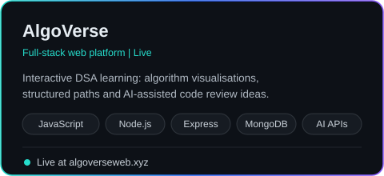
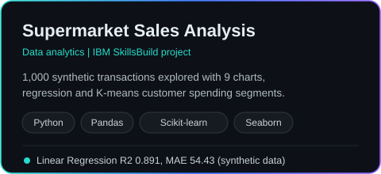
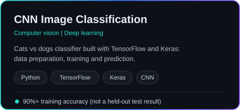
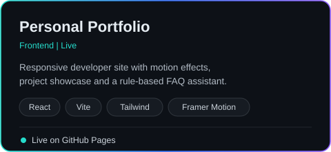

<div align="center">


<a href="https://algoverseweb.xyz/"></a>
<a href="https://vipinbhardwaj-07.github.io/VipinBhardwaj-portfolio/"></a>
<a href="https://www.linkedin.com/in/vipin-bhardwaj-55a5a93a9/"></a>
<a href="mailto:vipinbhardwaj0827@gmail.com"></a>
<a href="https://orcid.org/0009-0007-1312-4693"></a>


</div>

## About me

```python
class VipinBhardwaj:
    role      = "Aspiring AI Software Engineer"
    education = "B.Tech CSE, Sanskaram University (2024-2028)"
    focus     = ["Machine Learning", "Computer Vision", "Full-Stack Web", "DSA"]
    now       = "Strengthening DSA, software development and applied AI"
    open_to   = ["Internships", "Collaborations", "Learning opportunities"]
    motto     = "Learn deeply. Build thoughtfully. Improve continuously."
```

I'm a Computer Science undergraduate who likes turning ideas into working projects, from data analysis and
computer vision to full-stack web apps. I learn best by building, testing and improving.

<div align="center"></div>

## Featured projects

<table>
<tr>
<td width="50%"><a href="https://github.com/VipinBhardwaj-07/AlgoVerse"></a></td>
<td width="50%"><a href="https://github.com/VipinBhardwaj-07/Supermarket-Sales-Analysis"></a></td>
</tr>
<tr>
<td width="50%"><a href="https://github.com/VipinBhardwaj-07/CNN-Image-Classification"></a></td>
<td width="50%"><a href="https://github.com/VipinBhardwaj-07/VipinBhardwaj-portfolio"></a></td>
</tr>
</table>

> **Data note:** the Supermarket project uses synthetic data, and the CNN figure is training accuracy. Metrics describe
> these project datasets and are not validated forecasts or held-out test results.

## Tech stack

<div align="center"></div>

## Experience and learning

| Programme | Organisation | Duration |
|---|---|---|
| Data Analytics with AI Internship | AICTE, BharatCares, IBM SkillsBuild | 6 weeks, 17 Aug - 30 Sep 2026 |
| Artificial Intelligence Virtual Internship | NASSCOM, IBM, PBEL | Virtual internship |

**Certifications:** Python (GUVI) | Cloud Computing (Infosys) | YUVA AI (TCS iON) | Generative AI (SJF) | DSA (Skill Up) | AI / PBEL (NASSCOM)

## How I work

| Explore | Build | Analyse | Improve |
|:---:|:---:|:---:|:---:|
| Learn concepts and fundamentals | Turn ideas into working projects | Test, debug and understand results | Refine code and keep learning |

## GitHub activity

<div align="center">


<picture>
  <source media="(prefers-color-scheme: dark)" srcset="https://raw.githubusercontent.com/VipinBhardwaj-07/VipinBhardwaj-07/output/github-snake-dark.svg">
  
</picture>

</div>

## Let's connect

I'm always happy to connect with developers, learn from others and collaborate on meaningful projects.

<div align="center"></div>
