 
<div align="center">


<br/>

<a href="https://vipinbhardwaj-07.github.io/VipinBhardwaj-portfolio/">

</a>
<a href="https://github.com/VipinBhardwaj-07">

</a>
<a href="https://www.linkedin.com/in/vipin-bhardwaj-55a5a93a9/">

</a>
<a href="mailto:vipinbhardwaj0827@gmail.com">

</a>

<br/><br/>


<br/>


<br/><br/>

**CODE × AI × ALGORITHMS**

*Turning curiosity into code, ideas into products, and data into insights.*

</div>

---

<div align="center">

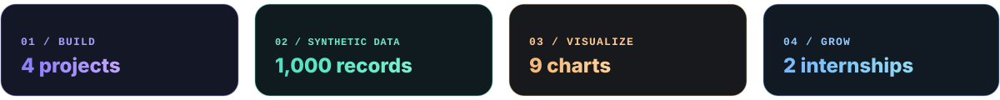

</div>

# `01` // WHO AM I?


Hey! I'm **Vipin Bhardwaj**, a Computer Science and Engineering student who enjoys building software, exploring artificial intelligence, and solving technical problems.

I'm interested in the intersection of **software engineering, AI, machine learning, and data-driven applications**. I enjoy taking an idea from its initial concept to a working application, experimenting with different technologies, and continuously improving the result.

My development journey combines practical projects, independent learning, internships, and problem-solving.

### My developer profile

- 🎓 B.Tech in Computer Science & Engineering — Sanskaram University (2024–2028)
- 🤖 Aspiring AI Software Engineer
- 💻 Interested in Full Stack Development
- 🧠 Learning Data Structures & Algorithms
- 📊 Exploring Data Analytics and Machine Learning
- 👁️ Interested in Computer Vision and Deep Learning
- 🚀 Building practical projects and web applications
- 🌱 Focused on continuous learning and improvement

<br clear="right"/>

### What drives me?

| Interest | What I enjoy exploring |
|---|---|
| Artificial Intelligence | Building intelligent and useful applications |
| Full Stack Development | Creating complete web experiences |
| Machine Learning | Training models and understanding data |
| Computer Vision | Teaching computers to interpret images |
| Data Analytics | Finding patterns and communicating insights |
| DSA | Developing logical and algorithmic thinking |

---

# `02` // TECHNICAL ARSENAL


I work with a growing set of programming languages, frameworks, libraries, and development tools.

### Programming languages

<p align="left">

</p>

| Technology | My focus |
|---|---|
| Python | Data analysis, scripting, AI and ML |
| Java | Programming fundamentals and problem-solving |
| C | Programming fundamentals and logic building |
| JavaScript | Interactive web development |
| HTML5 | Semantic web structure |
| CSS3 | Responsive layouts and visual styling |

### Frontend development

<p>

</p>

- Responsive layouts and reusable UI components.
- Interactive web interfaces.
- React component-based development.
- Modern styling using Tailwind CSS.
- UI animations and motion effects.

### Backend development

<p>

</p>

- Node.js and Express.js.
- REST API development.
- Server-side application logic.
- Authentication and backend integration.
- Working with application data.

### AI, Machine Learning & Computer Vision

<p>

</p>

- Machine Learning fundamentals.
- Supervised learning and model evaluation.
- Linear Regression.
- K-Means clustering.
- Convolutional Neural Networks.
- Image preprocessing and classification.

### Data analytics ecosystem

<p>


</p>

### Databases and development tools

<p>

</p>

**Currently strengthening:** DSA, advanced Java, Machine Learning, backend engineering, and AI application development.

---

# `03` // HOW I BUILD


I believe good software is not just about writing code. It is about understanding the problem, designing a sensible solution, building it carefully, and improving it through testing.

### My development workflow

<div align="center">

| Phase | What happens |
|:---:|---|
| 🔍 DISCOVER | Understand the problem and requirements |
| 🧠 PLAN | Break the problem into manageable components |
| 🎨 DESIGN | Plan the structure, interface and user experience |
| ⚙️ DEVELOP | Implement the frontend, backend and core logic |
| 🧪 TEST | Debug, validate and improve functionality |
| 🚀 DEPLOY | Publish the application and make it accessible |
| 🔄 IMPROVE | Learn from feedback and continue refining |

</div>


### My engineering principles

- **Readable code:** Prefer understandable and maintainable implementations.
- **User experience:** Build interfaces that are clear and easy to navigate.
- **Practical learning:** Apply concepts through real projects.
- **Problem-solving:** Break complex problems into smaller steps.
- **Iteration:** Test, learn, and improve instead of stopping at the first version.

---

# `04` // UI/UX & PRODUCT THINKING

I enjoy building interfaces that balance visual quality with practical usability.

My design interests include:

- Dark interfaces with clear visual hierarchy.
- Consistent spacing, typography, and color systems.
- Responsive layouts for desktop and mobile.
- Smooth transitions and meaningful animations.
- Accessible and understandable navigation.
- Interfaces that make technical information easier to explore.

**My preferred design direction:** Clean, modern, technical, and functional — with visual details that support the user rather than distract them.


---

# `05` // LEARNING ROADMAP

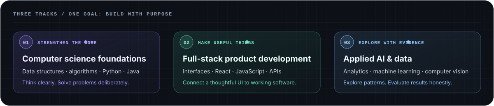

| Learning area | Direction |
|---|---|
| Data Structures & Algorithms | Arrays, strings, recursion, trees, graphs and problem-solving |
| Artificial Intelligence | AI concepts, applications and intelligent systems |
| Machine Learning | Data preprocessing, model training and evaluation |
| Deep Learning | Neural networks and CNN architectures |
| Computer Vision | Image preprocessing and classification |
| Full Stack Development | Frontend, backend and database integration |
| Data Analytics | EDA, visualization and statistical analysis |
| Software Engineering | Clean architecture, testing and maintainability |

*This is an ongoing learning roadmap, not a claim that every topic has been mastered.*

---

# `06` // PROJECT ATLAS

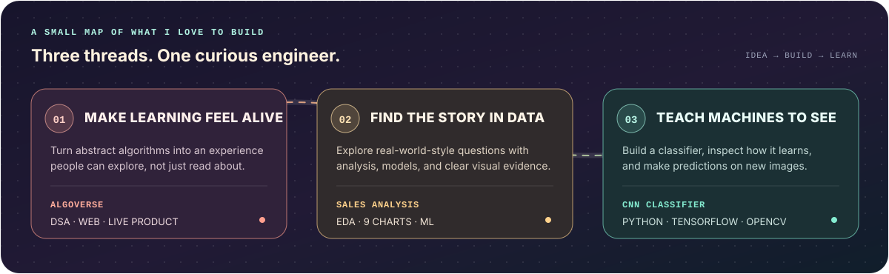

My projects are where I connect concepts with practical implementation. Each project represents a different part of my development journey — web engineering, data analytics, machine learning, and frontend development.

---

## PROJECT 01 — AlgoVerse

<div align="center">

<a href="https://algoverseweb.xyz/">
</a>


### ALGORITHM LEARNING × VISUALIZATION × AI

**Master the Art of Algorithms.**

<a href="https://algoverseweb.xyz/">

</a>
<a href="https://github.com/VipinBhardwaj-07/AlgoVerse">

</a>

</div>

### Overview

**AlgoVerse** is an interactive Data Structures and Algorithms learning platform created to make technical concepts easier to understand through structured learning resources, visual explanations, and AI-powered assistance.

The motivation behind this project is simple: many students find algorithms difficult when they only study definitions and code. AlgoVerse aims to make learning more approachable by combining explanations, visual learning, coding resources, and a modern user interface.

### Key features

| Feature | Description |
|---|---|
| 📚 Structured DSA learning | Organizes learning material into accessible topics and learning paths |
| 📊 Algorithm visualizations | Helps learners understand how algorithms work step by step |
| 🧠 Graph algorithms | Supports exploration of graph-related concepts |
| ⚡ Dynamic programming | Provides learning resources for DP concepts and patterns |
| 💻 Coding practice | Supports a more practical approach to algorithm learning |
| 🤖 AI learning assistant | Provides AI-based learning support and explanations |
| 🔐 User authentication | Includes account-related functionality |
| 🎨 Responsive interface | Designed for different screen sizes |
| 🌙 Dark UI | Uses a modern developer-focused visual design |

### Technology stack

<p>

</p>

- **HTML5:** Page structure and content.
- **CSS3:** Styling, layouts, responsiveness and visual effects.
- **JavaScript:** Frontend functionality and interactions.
- **Node.js:** Backend runtime.
- **Express.js:** Server-side routes and API functionality.
- **AI API integration:** AI-powered learning assistance.
- **Database:** Application data and user-related functionality.

### What I worked on

- Building the website interface and learning experience.
- Organizing DSA content and learning sections.
- Implementing frontend interactions and responsive layouts.
- Connecting the frontend with backend functionality.
- Integrating AI-powered assistance.
- Working on authentication and application flow.
- Improving navigation and the overall learning experience.

### Architecture overview

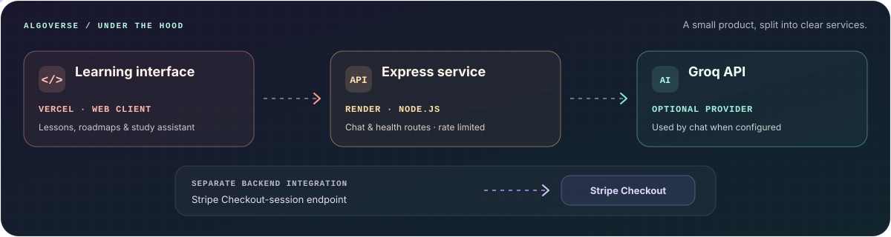

### What I learned

- Connecting frontend interfaces with backend services.
- Structuring a multi-page web application.
- Working with API integrations.
- Designing a learning-focused user experience.
- Managing application functionality across frontend and backend.

<div align="center">

**Explore AlgoVerse**

[Live Website](https://algoverseweb.xyz/) · [Source Code](https://github.com/VipinBhardwaj-07/AlgoVerse)

</div>

---

## PROJECT 02 — Supermarket Sales Analysis

<div align="center">

<a href="https://github.com/VipinBhardwaj-07/Supermarket-Sales-Analysis">
</a>


### DATA ANALYSIS × VISUALIZATION × PREDICTION

<a href="https://github.com/VipinBhardwaj-07/Supermarket-Sales-Analysis">

</a>

</div>

### Overview

**Supermarket Sales Analysis** is an end-to-end data analytics project developed during my Data Analytics with AI learning experience.

The objective is to explore supermarket transaction records and transform raw data into understandable information about sales patterns, product performance, customer behavior, and business trends.

The project combines data preparation, exploratory data analysis, visual storytelling, and machine learning techniques in a reproducible workflow.

### Analytics workflow

<div align="center">

`RAW DATA` → `DATA CLEANING` → `EDA` → `VISUALIZATION` → `MACHINE LEARNING` → `INSIGHTS`

</div>

### Dataset details

<details>
<summary><b>View dataset information</b></summary>

The project uses a reproducible, synthetically generated dataset containing **1,000 supermarket transactions**.

The data includes:

- Multiple supermarket branches and locations.
- Product categories.
- Member and normal customer types.
- Customer gender information.
- Unit prices and quantities.
- Transaction dates and hours.
- Payment methods.
- Customer ratings.
- Total sales values.

Important fields include `invoice_id`, `branch`, `city`, `customer_type`, `product_line`, `unit_price`, `quantity`, `sales`, `date`, `hour`, `payment_method`, and `rating`.

The dataset is generated by the project's data-generation script. It is not an actual retailer's transaction database.

</details>

### Analysis performed

**1. Data cleaning and preprocessing**

- Duplicate record handling.
- Missing-value treatment.
- Date conversion and preparation.
- Standardization of selected categorical values.
- Feature engineering.
- Statistical summaries.

**2. Exploratory data analysis**

The analysis explores:

- Product-line performance.
- Branch-wise sales patterns.
- Customer types and purchasing behavior.
- Sales distribution.
- Shopping time and hourly trends.
- Payment-method preferences.
- Customer ratings.
- Relationships between transaction features.

**3. Data visualization**

The project includes **nine analytical visualizations** to communicate patterns and make the results easier to interpret.

**4. Machine learning**

Two machine learning approaches are included:

| Model | Purpose |
|---|---|
| Linear Regression | Explore sales prediction |
| K-Means Clustering | Group customers by spending patterns |

The clustering workflow uses preprocessing techniques including feature scaling and encoding where appropriate.

### Reported project results

<div align="center">


<br/><br/>

| Metric | Reported result |
|---|---:|
| Linear Regression R² | 0.891 |
| Mean Absolute Error | 54.43 sales units |
| K-Means segments | 3 |

</div>

**Important interpretation:** These are reported results from the project's synthetic dataset. They are not proof of real-world retail forecasting performance. The quality of the results depends on the generated data and evaluation methodology.

### Technology stack

<p>


</p>

### Project deliverables

- Data-generation and preparation scripts.
- Cleaned transaction dataset.
- Exploratory data analysis.
- Nine analytical charts.
- Machine learning experiments.
- Executed Jupyter Notebook.
- PDF project report.

### What I learned

- Working with structured datasets.
- Data cleaning and preprocessing.
- Exploratory data analysis.
- Visualizing business-related patterns.
- Applying regression and clustering.
- Interpreting model evaluation metrics.
- Communicating analytical findings responsibly.

<div align="center">

[View Supermarket Sales Analysis Repository](https://github.com/VipinBhardwaj-07/Supermarket-Sales-Analysis)

</div>

---

## PROJECT 03 — CNN Image Classification: Cats vs Dogs

<div align="center">

<a href="https://github.com/VipinBhardwaj-07/CNN-Image-Classification">
</a>


### DEEP LEARNING × CNN × IMAGE CLASSIFICATION

<a href="https://github.com/VipinBhardwaj-07/CNN-Image-Classification">

</a>

</div>

### Overview

**CNN Image Classification — Cats vs Dogs** is a deep learning project that uses a Convolutional Neural Network to distinguish between images belonging to two categories: cats and dogs.

The project explores how image data can be processed and passed through a neural network to learn visual patterns and generate predictions.

It was developed to gain practical experience with deep learning, image preprocessing, model training, and prediction workflows.

### How the project works

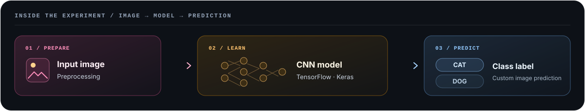

1. **Image input:** Load cat and dog image data.
2. **Preprocessing:** Prepare and normalize images for model input.
3. **Model training:** Train a CNN to learn useful image features.
4. **Evaluation:** Inspect training and validation performance graphs.
5. **Prediction:** Use the prediction script to classify new images.

### Main features

- Binary image classification.
- Cat and dog image recognition.
- Image preprocessing and normalization.
- CNN model training.
- Prediction on custom images.
- Training accuracy visualization.
- Validation accuracy visualization.
- Loss visualization.

### Technology stack

<p>


</p>

### Model information

| Item | Details |
|---|---|
| Model type | Convolutional Neural Network |
| Problem type | Binary image classification |
| Classes | Cat and Dog |
| Framework | TensorFlow / Keras |
| Reported training accuracy | 90%+ |
| Prediction script | `predict.py` |

**Evaluation note:** The repository reports 90%+ training accuracy. This should not be confused with validation or test accuracy. The training, validation, and loss graphs are available in the repository for further evaluation.

### Run the project

```bash
git clone https://github.com/VipinBhardwaj-07/CNN-Image-Classification.git

cd CNN-Image-Classification

pip install -r requirements.txt

# Train the CNN model
python main.py

# Predict an image
python predict.py
```

### What I learned

- Image preprocessing and normalization.
- CNN fundamentals.
- Neural network training.
- Working with TensorFlow and Keras.
- Understanding accuracy and loss curves.
- Separating model training from prediction.

<div align="center">

[Explore CNN Image Classification](https://github.com/VipinBhardwaj-07/CNN-Image-Classification)

</div>

---

## PROJECT 04 — Personal Developer Portfolio

<div align="center">

<a href="https://vipinbhardwaj-07.github.io/VipinBhardwaj-portfolio/">
</a>


### PERSONAL BRANDING × REACT × INTERACTIVE UI

<a href="https://vipinbhardwaj-07.github.io/VipinBhardwaj-portfolio/">

</a>
<a href="https://github.com/VipinBhardwaj-07/VipinBhardwaj-portfolio">

</a>

</div>

### Overview

My personal portfolio is a React-based website designed to present my technical journey, development skills, projects, and professional information in one place.

The project focuses on building a structured, responsive, and visually engaging portfolio using reusable components and modern frontend tools.

### Main features

- Responsive portfolio layout.
- Component-based React architecture.
- Dedicated sections for introduction, skills, projects and experience.
- Animated interface elements.
- Framer Motion transitions.
- Centralized content configuration.
- Rule-based FAQ assistant.
- Portfolio deployment through GitHub Pages.

### Technology stack

<p>


</p>

### Architecture and development

The portfolio uses a component-based structure to keep individual sections organized and maintainable.

The content is centralized in a data file, making it easier to update personal details, project information, skills, and FAQ content without changing every component.

The FAQ assistant uses predefined answers and does not require an external AI API key.

### What I learned

- Building React applications using reusable components.
- Organizing content separately from presentation.
- Implementing motion and transition effects.
- Creating responsive portfolio layouts.
- Deploying a Vite application to GitHub Pages.

<div align="center">

[Open Live Portfolio](https://vipinbhardwaj-07.github.io/VipinBhardwaj-portfolio/) · [View GitHub Repository](https://github.com/VipinBhardwaj-07/VipinBhardwaj-portfolio)

</div>

---

# `07` // LAB RESULTS — BUILDING & EXPERIMENTING

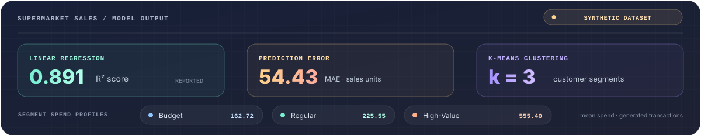

I enjoy experimenting with different areas of computer science and applying what I learn through practical implementation.

### My development lab

| Domain | Practical exploration |
|---|---|
| Web engineering | Responsive websites and full-stack applications |
| AI integration | AI-powered application features and assistants |
| Data analytics | Data preparation, EDA and visualization |
| Machine learning | Regression and clustering experiments |
| Computer vision | CNN-based image classification |
| Algorithms | DSA concepts and algorithmic problem-solving |

### My learning philosophy

> Build something small. Understand how it works. Improve it. Then build something more ambitious.

I value projects that demonstrate actual implementation rather than simply listing technologies.

---

# `08` // EXPERIENCE & INTERNSHIPS

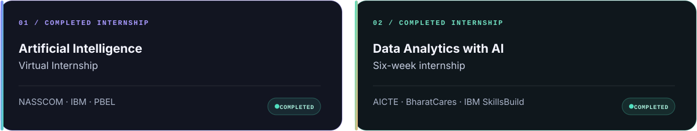

### 01. Artificial Intelligence Virtual Internship

<details>
<summary><b>NASSCOM · IBM · PBEL</b></summary>

**Domain:** Artificial Intelligence

This virtual internship provided exposure to artificial intelligence concepts and structured learning activities.

It contributed to my interest in AI-based applications and practical technology development.

**Learning focus:**
- Artificial intelligence fundamentals.
- AI-related learning activities.
- Understanding practical AI applications.
- Connecting concepts with project-based learning.

</details>

### 02. Data Analytics with AI Internship

<details>
<summary><b>AICTE · BharatCares · IBM SkillsBuild</b></summary>

**Duration:** 6 weeks

**Period:** 17 August – 30 September 2026

**Domain:** Data Analytics with AI

This internship focused on data analytics and AI-related learning. As part of my practical work, I developed the Supermarket Sales Analysis project.

**Project work included:**
- Preparing and cleaning transaction data.
- Exploring data using Python.
- Creating visualizations.
- Applying machine learning techniques.
- Documenting analysis and project results.

</details>

---

# `09` // EDUCATION & CERTIFICATIONS

### Education

<div align="center">


</div>

**Sanskaram University**

Bachelor of Technology — Computer Science & Engineering

**2024–2028**

### Certifications and learning programs

| Program / Certification | Organization |
|---|---|
| Python | GUVI |
| Cloud Computing | Infosys |
| YUVA AI | TCS iON |
| PBEL | NASSCOM |
| Generative AI | SJF |
| Data Structures & Algorithms | Skill Up |
| Data Analytics with AI Internship | IBM SkillsBuild / AICTE / BharatCares |

---

# `10` // GITHUB ANALYTICS

<div align="center">


<br/><br/>


<br/><br/>


</div>

---

# `11` // CONTRIBUTION MATRIX

<div align="center">

### EVERY CONTRIBUTION IS PART OF THE JOURNEY


</div>

---

# `12` // CURRENTLY EXPLORING


My current priorities are:

- Strengthening Data Structures & Algorithms.
- Building practical AI-powered applications.
- Improving my Machine Learning foundations.
- Exploring deep learning and computer vision.
- Developing more advanced full-stack projects.
- Learning better software architecture and engineering practices.

### What's next?

I want to work on projects that combine AI with real-world software applications, improve my technical depth, and become a stronger software engineer.

---

# `13` // DEVELOPER MINDSET

<div align="center">


</div>

```python
class VipinBhardwaj:

    def __init__(self):
        self.role = "Aspiring AI Software Engineer"

        self.interests = [
            "Artificial Intelligence",
            "Full Stack Development",
            "Machine Learning",
            "Computer Vision",
            "Data Structures & Algorithms"
        ]

        self.mindset = "Learn. Build. Improve."

    def daily_workflow(self):
        return [
            "Explore new technologies",
            "Understand problems",
            "Write and test code",
            "Build practical projects",
            "Improve continuously"
        ]

developer = VipinBhardwaj()
```

<div align="center">

**Curiosity is the starting point. Consistency makes the difference.**

</div>

---

# `14` // CONNECT & COLLABORATE


<div align="center">

### LET'S BUILD SOMETHING MEANINGFUL.

I'm interested in connecting with developers, students, mentors, and people working on interesting technology projects.

Whether it's software development, AI, machine learning, or a collaborative project — let's connect.

<br/>

<a href="https://github.com/VipinBhardwaj-07">

</a>
<a href="https://www.linkedin.com/in/vipin-bhardwaj-55a5a93a9/">

</a>
<a href="https://vipinbhardwaj-07.github.io/VipinBhardwaj-portfolio/">

</a>
<a href="mailto:vipinbhardwaj0827@gmail.com">

</a>

<br/><br/>

### "Code with purpose. Learn with curiosity. Build with consistency."

<br/>


</div>
