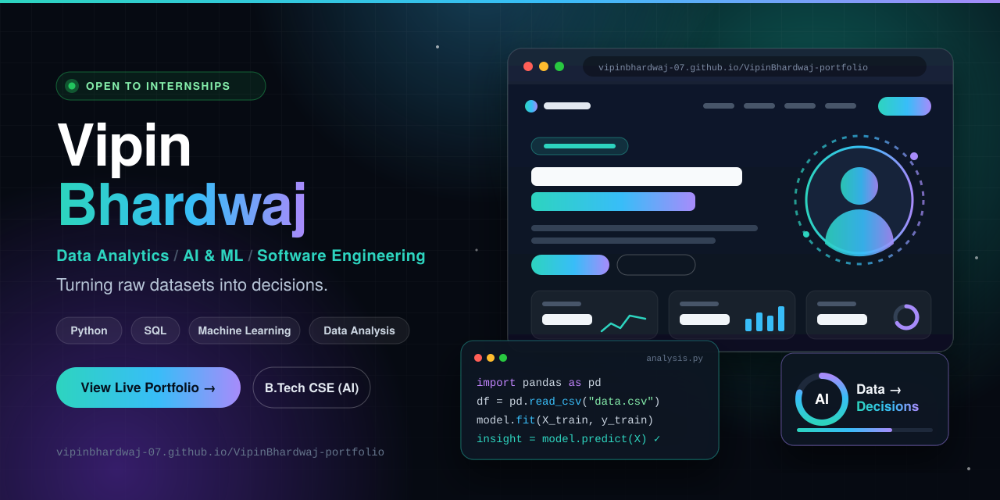
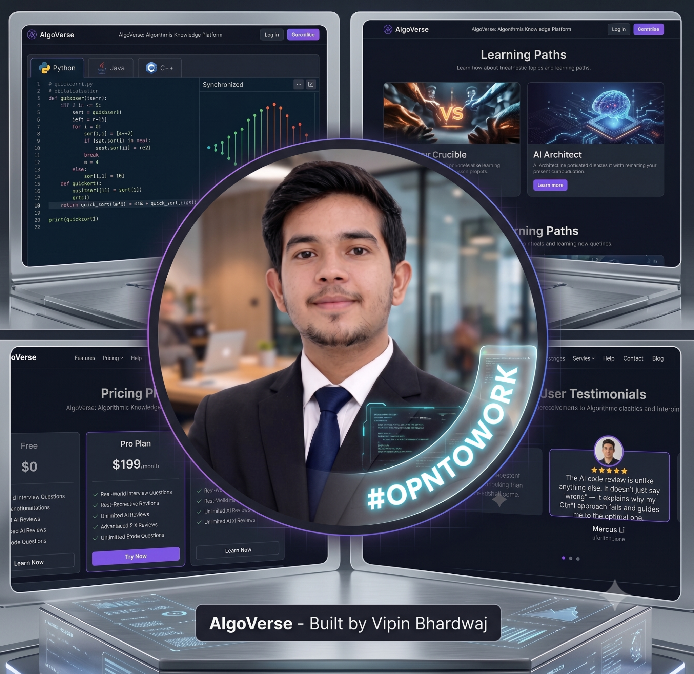
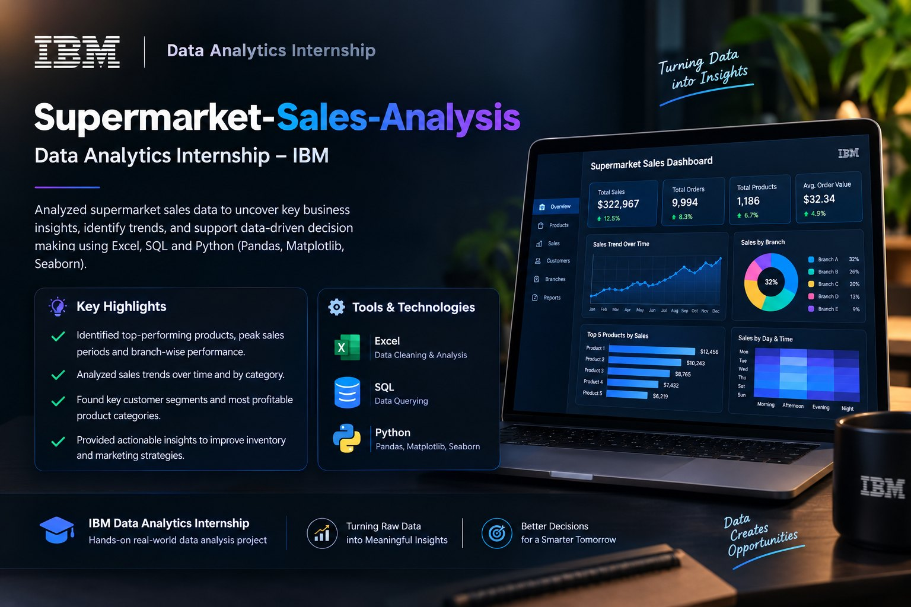
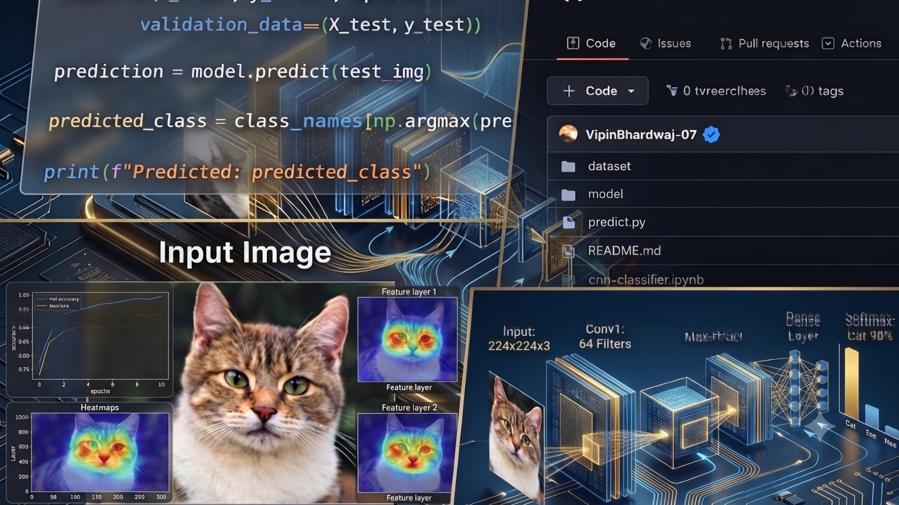

  
  
  

  
  
  
  

whoami — About Me
Hey! I'm Vipin Bhardwaj, a Computer Science undergraduate interested in building practical software at the intersection of AI, machine learning, data, and full-stack development.
- 🎓 B.Tech in Computer Science & Engineering — Sanskaram University (2024–2028)
- 🤖 Aspiring AI Software Engineer
- 💻 Interested in full-stack engineering, machine learning, computer vision, and problem solving
- 🧪 I enjoy turning concepts into working projects and learning by building
- 🌱 Currently strengthening my foundations in DSA, software development, and applied AI
- 🤝 Open to learning opportunities, internships, and collaborative projects
My approach: Learn deeply. Build thoughtfully. Improve continuously.

⚡ Featured Projects
01 · AlgoVerse — Interactive DSA Learning Platform

  
   
  Project showcase visual for AlgoVerse

An interactive platform designed to make Data Structures and Algorithms easier to explore and practise.
- Interactive algorithm visualizations and coding-focused learning resources
- Learning paths for structured DSA practice
- AI-assisted learning experience and code-review concepts
- Authentication and backend-powered features
Tech: HTML CSS JavaScript Node.js Express.js MongoDB AI APIs

  
  

02 · Supermarket Sales Analysis — Data Analytics

  
   
  Project showcase visual for the IBM SkillsBuild data analytics project

A data analysis project exploring supermarket transaction patterns and extracting insights through visualization and machine learning.
- Analysed a dataset containing 1,000 synthetic transaction records
- Created 9 visualizations to explore sales and customer patterns
- Applied Linear Regression (reported project result: R² = 0.891, MAE = 54.43 sales units)
- Used K-means to explore 3 customer spending segments
- Explored product, sales, and customer trends
Tech: Python Pandas NumPy Matplotlib Seaborn Scikit-learn Jupyter Notebook
Data note: The project uses synthetic data. Metrics describe this project dataset and should not be interpreted as validated business forecasts.

  

03 · CNN Image Classification — Cats vs Dogs

  
   
  Project showcase visual for the CNN image classification project

A computer vision project using a Convolutional Neural Network to classify images into two categories: cats and dogs.
- Built a CNN image-classification workflow with TensorFlow and Keras
- Prepared image data for model training and prediction
- Explored training behaviour and model predictions
- The repository reports 90%+ training accuracy; this is training accuracy, not a held-out test result
Tech: Python TensorFlow Keras CNN Computer Vision Jupyter Notebook

  

04 · Personal Portfolio — Developer Website

  
   
  Portfolio hero visual

A responsive personal website presenting my background, skills, projects, and development journey.
- Project-focused portfolio layout
- Responsive interface and motion effects
- Skills, certifications, and contact sections
- Rule-based FAQ assistant
Tech: React Vite JavaScript Tailwind CSS Framer Motion

  
  

🧰 Tech Stack

Languages
Frontend & Backend
AI, Machine Learning & Data

 

Databases & Developer Tools

💼 Internship Experience
Programme	Organization / Partners	Duration
Data Analytics with AI Internship	AICTE · BharatCares · IBM SkillsBuild	6 weeks · 17 Aug–30 Sep 2026
Artificial Intelligence Virtual Internship	NASSCOM · IBM · PBEL	Virtual internship

Certifications & Learning
- Python — GUVI
- Cloud Computing — Infosys
- YUVA AI — TCS iON
- Generative AI — SJF
- Data Structures & Algorithms — Skill Up
- AI / PBEL learning programme — NASSCOM
🧠 Developer Mindset

Explore	Build	Analyse	Improve
Learn concepts and fundamentals	Turn ideas into working projects	Test, debug, and understand results	Refine code and keep learning
📚	🛠️	🔍	🚀

I value clean problem-solving, curiosity, consistency, and learning through practical implementation.
📊 GitHub Activity

  
  

  

  

🤝 Let's Connect
I'm always interested in connecting with developers, learning from others, and collaborating on meaningful projects.

  
  
  

Build with purpose. Learn without limits.

