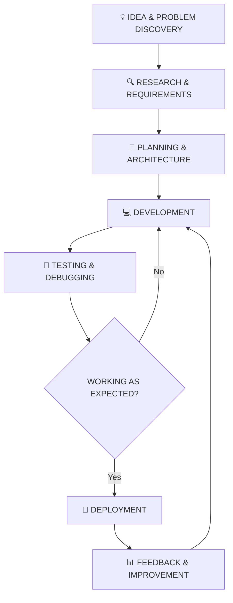

 <div align="center">

<!-- ====================================================== -->
<!--                 VIPIN BHARDWAJ PROFILE                  -->
<!--               ULTIMATE DEVELOPER EDITION                -->
<!-- ====================================================== -->


<br/>


<br/><br/>

<a href="https://algoverseweb.xyz/">

</a>
<a href="https://portfolio-tan-iota-77.vercel.app/">

</a>
<a href="https://github.com/VipinBhardwaj-07?tab=repositories">

</a>

<br/><br/>

<a href="https://github.com/VipinBhardwaj-07">

</a>
<a href="https://github.com/VipinBhardwaj-07?tab=followers">

</a>

<br/><br/>

**WELCOME TO MY DIGITAL WORLD**

*Where technology meets imagination, algorithms meet intelligence, and ideas become reality.*

<br/>

[GitHub](https://github.com/VipinBhardwaj-07) • [LinkedIn](https://www.linkedin.com/in/vipin-bhardwaj-55a5a93a) • [Portfolio](https://portfolio-tan-iota-77.vercel.app/) • [Email](mailto:vipinbhardwaj0827@gmail.com)

</div>

---

<div align="center">

# ◈ THE DEVELOPER BEHIND THE CODE ◈

### I DON'T JUST WRITE CODE. I BUILD EXPERIENCES.

</div>

<table>
<tr>
<td width="60%" valign="top">

## 👨‍💻 ABOUT ME

Hey! I'm **Vipin Bhardwaj**, a Computer Science Engineering student, aspiring AI Software Engineer, and technology enthusiast from India.

My journey in technology is driven by curiosity, experimentation, creativity, and a strong desire to understand how things work.

I enjoy transforming ideas into practical software, exploring intelligent systems, solving programming challenges, and developing digital products that provide real value.

My primary interests lie at the intersection of:

- Artificial Intelligence and Machine Learning.
- Full Stack Software Development.
- Data Structures and Algorithms.
- Generative AI and intelligent applications.
- Computer Vision and Deep Learning.
- Software Engineering and Research.

I believe that great engineering is not simply about writing more code. It is about understanding problems, designing effective solutions, and continuously improving the way technology works.

**My ultimate goal:** To grow into an AI Software Engineer capable of designing, developing, and deploying intelligent real-world applications.

</td>
<td width="40%" align="center" valign="middle">


<br/><br/>


<br/><br/>

<br/><br/>


</td>
</tr>
</table>

### 🧬 DEVELOPER PROFILE

| Attribute | Details |
|---|---|
| Name | Vipin Bhardwaj |
| Primary Role | Aspiring AI Software Engineer |
| Education | B.Tech, Computer Science & Engineering |
| University | Sanskaram University |
| Location | India |
| Primary Language | Python |
| Other Languages | Java, C, JavaScript |
| Development Interest | Full Stack Development |
| AI Interest | Artificial Intelligence & Machine Learning |
| Problem Solving | Data Structures & Algorithms |
| Current Approach | Learn → Build → Experiment → Improve |

### ⚡ MY DEVELOPER PHILOSOPHY

> "The best way to predict the future of technology is to build something that contributes to it."

- I believe in learning by building.
- I believe practical projects create meaningful experience.
- I believe consistency matters more than perfection.
- I believe curiosity is the foundation of innovation.
- I believe every complex problem has an opportunity for a better solution.

---

# 🖥️ 01. VIPIN.EXE — DEVELOPER TERMINAL

<sub>BOOT SEQUENCE INITIATED • DEVELOPER INFORMATION SYSTEM</sub>

```bash
╔══════════════════════════════════════════════════════════╗
║                  VIPIN.EXE / SYSTEM                      ║
║                DEVELOPER INFORMATION                     ║
╚══════════════════════════════════════════════════════════╝

[BOOT] Loading developer identity...
[OK]   Identity verified: Vipin Bhardwaj

[USER]
  Name     : Vipin Bhardwaj
  Role     : Aspiring AI Software Engineer
  Education: Computer Science Engineering
  Location : India

[INTERESTS]
  01. Artificial Intelligence
  02. Machine Learning
  03. Full Stack Development
  04. Deep Learning
  05. Data Structures & Algorithms
  06. Generative AI

[CURRENT STATUS]
  Learning     : ACTIVE
  Development  : ACTIVE
  Experiment   : ACTIVE
  Innovation   : IN PROGRESS

[MISSION]
  Transform ideas into intelligent applications.

[STATUS] SYSTEM READY.
```

### 🔍 CURRENT DEVELOPER STATUS

| Area | Current Focus |
|---|---|
| Programming | Python, Java, C and JavaScript |
| Web Engineering | Frontend and Backend Development |
| Artificial Intelligence | AI applications and GenAI |
| Machine Learning | Fundamentals and practical projects |
| Algorithms | DSA and logical problem solving |
| Deployment | GitHub and Vercel |
| Professional Growth | Internships, projects and research |

---

# 🧰 02. TECHNOLOGY ECOSYSTEM

<div align="center">

**MY DIGITAL TOOLKIT — THE TECHNOLOGIES I USE AND EXPLORE**

</div>

## 💻 Programming Languages

I work with programming languages to develop applications, solve computational problems, understand programming fundamentals, and explore different areas of software engineering.

<div align="center">


</div>

| Technology | Application |
|---|---|
| Python | AI, ML, automation and programming |
| Java | Object-oriented programming and problem solving |
| C | Programming fundamentals and logical thinking |
| HTML | Web structure and content |
| CSS | Layout, styling and interface design |
| JavaScript | Interactive web applications |

## 🌐 Frontend Development

Focused on creating attractive, accessible, interactive, and user-friendly interfaces.

<div align="center">


</div>

**Areas of interest:**

- Responsive web design.
- Modern interface development.
- Interactive user experiences.
- Component-based development.
- Website optimization.
- Frontend architecture.

## ⚙️ Backend Development

Exploring server-side engineering, application logic, API development, and database integration.

<div align="center">


</div>

**Areas of interest:**

- REST API development.
- Backend application architecture.
- Authentication systems.
- Database fundamentals.
- Server-side JavaScript.
- Application deployment.

## 🤖 Artificial Intelligence & Machine Learning

One of my most important learning directions is developing an understanding of intelligent systems and machine learning technologies.

<div align="center">


</div>

**Areas of interest:**

- Machine learning fundamentals.
- Neural networks.
- Convolutional Neural Networks.
- Computer vision.
- Generative AI.
- AI-powered applications.
- Intelligent automation.
- Data-driven systems.

## 🛠️ Developer Tools & Platforms

<div align="center">


</div>

| Tool | Purpose |
|---|---|
| Git | Version control |
| GitHub | Code hosting and collaboration |
| VS Code | Development environment |
| Vercel | Application hosting and deployment |
| Windows | Primary development environment |

---

# 🚀 03. PROJECT LABORATORY

<div align="center">


</div>

*This is where concepts become working applications. Each project represents an opportunity to learn, experiment, solve problems, and improve my engineering skills.*

## 🌌 PROJECT 01 — ALGOVERSE

<badge color="success">Live Project</badge> <badge color="discovery">Featured</badge>

<div align="center">


<br/><br/>

<a href="https://algoverseweb.xyz/">

</a>

<br/><br/>

<a href="https://algoverseweb.xyz/">

</a>
<a href="https://github.com/VipinBhardwaj-07/AlgoVerse">

</a>

</div>

### Overview

**AlgoVerse** is an interactive Data Structures and Algorithms learning platform designed to make complex computer science concepts easier to understand through visualizations, structured learning, coding practice, and AI-assisted features.

The goal behind the project is to create a more engaging environment where learners can understand how algorithms work instead of simply memorizing their implementations.

### Key Features

| Feature | Description |
|---|---|
| Interactive Visualizations | Visual learning experiences for algorithmic concepts |
| AI Code Reviews | AI-assisted feedback and code analysis |
| Graph Algorithms | Explore graph-related algorithms |
| Dynamic Programming | Learn and understand DP concepts |
| Coding Practice | Practice programming and problem solving |
| Learning Paths | Structured DSA learning experience |
| Authentication | User account and access functionality |

### Technology Stack

`HTML` `CSS` `JavaScript` `Node.js` `Express.js`

### Engineering Goals

- Make algorithm learning more visual.
- Improve the learning experience through interactive features.
- Integrate AI-assisted programming functionality.
- Build a structured educational platform.
- Develop a maintainable web application.

**Project links**

- Live: https://algoverseweb.xyz/
- GitHub: https://github.com/VipinBhardwaj-07/AlgoVerse

---

## 🧠 PROJECT 02 — CNN IMAGE CLASSIFICATION

<badge color="success">GitHub Project</badge> <badge color="discovery">Machine Learning</badge>

<div align="center">


<br/><br/>

<a href="https://github.com/VipinBhardwaj-07/CNN-Image-Classification">

</a>

<br/><br/>

<a href="https://github.com/VipinBhardwaj-07/CNN-Image-Classification">

</a>

</div>

### Overview

The CNN Image Classification project explores the use of Convolutional Neural Networks to classify images into different categories.

The project focuses on the popular Cats vs Dogs classification problem and provides practical exposure to computer vision and deep learning fundamentals.

### Project Objectives

- Understand the fundamentals of CNNs.
- Explore image classification workflows.
- Learn how image data is processed.
- Experiment with neural network models.
- Understand the training and prediction process.

### Core Concepts

- Image preprocessing.
- Convolutional layers.
- Feature extraction.
- Neural network training.
- Classification and prediction.
- Model evaluation.

### Technology Stack

`Python` `CNN` `Machine Learning` `Deep Learning` `Computer Vision`

**Repository:** https://github.com/VipinBhardwaj-07/CNN-Image-Classification

---

## 📞 PROJECT 03 — AI VOICE SALES BOT

<badge color="success">Deployed Application</badge> <badge color="discovery">AI Application</badge>

<div align="center">


<br/><br/>

<a href="https://ai-voice-sales-bot-mu.vercel.app/">

</a>

<a href="https://github.com/VipinBhardwaj-07/ai-voice-sales-bot">

</a>

</div>

### Overview

An AI-powered voice sales assistant concept developed to explore conversational interfaces, voice interactions, call management, and AI-assisted sales workflows.

The project combines voice interaction concepts with application logic to create a structured user experience.

### Features

- Voice-based conversational interaction.
- Live transcript display.
- Call controls and duration tracking.
- Consent-based recording functionality.
- Recording playback.
- AI-generated call summaries.
- Sales status management.
- Persistent call history.

### Technology Stack

`HTML` `CSS` `JavaScript` `Node.js` `AI APIs`

### Project Links

- Live Application: https://ai-voice-sales-bot-mu.vercel.app/
- GitHub Repository: https://github.com/VipinBhardwaj-07/ai-voice-sales-bot

---

## 📊 PROJECT 04 — SUPERMARKET SALES ANALYSIS

<badge color="info">Data Analytics</badge> <badge color="discovery">IBM SkillsBuild</badge>

### Overview

A data analytics project completed as part of my IBM SkillsBuild learning experience.

The project focuses on exploring supermarket sales data, understanding business patterns, and developing analytical thinking.

### Areas of Work

- Understanding the dataset.
- Exploring data characteristics.
- Data cleaning and preparation.
- Identifying patterns and trends.
- Analyzing sales information.
- Deriving meaningful observations.

### Learning Outcomes

- Practical data analysis exposure.
- Better understanding of structured datasets.
- Analytical and problem-solving practice.
- Understanding how data can support business decisions.

### Technology

`Python` `Data Analytics` `Data Analysis` `Visualization`

---

## 🌐 PROJECT 05 — PERSONAL DEVELOPER PORTFOLIO

<badge color="success">Live Website</badge>

<div align="center">

<a href="https://portfolio-tan-iota-77.vercel.app/">

</a>

<a href="https://github.com/VipinBhardwaj-07/VipinBhardwaj-portfolio">

</a>

</div>

### Overview

My personal developer portfolio is designed to present my technical skills, projects, professional identity, and development journey in one place.

### Objectives

- Establish a professional developer identity.
- Showcase technical projects.
- Present my learning journey.
- Share professional contact information.
- Create an accessible online portfolio.

### Technology Stack

`React` `JavaScript` `Vite` `CSS`

**Live:** https://portfolio-tan-iota-77.vercel.app/

---

# 📈 04. GITHUB INTELLIGENCE DASHBOARD

<div align="center">

### MY OPEN-SOURCE DEVELOPMENT ACTIVITY


<br/><br/>

<table>
<tr>
<td width="50%">

</td>
<td width="50%">

</td>
</tr>
</table>

<br/>


</div>

### 📌 WHAT THESE METRICS REPRESENT

| Metric | Purpose |
|---|---|
| GitHub Statistics | Public repository and contribution information |
| Top Languages | Languages detected in public repositories |
| Contribution Activity | Recorded GitHub contribution history |
| Contribution Streak | Consecutive days of recorded contributions |

<sub>Statistics are dynamically retrieved from external GitHub statistics services. Availability and refresh times may vary.</sub>

---

# 🐍 05. CONTRIBUTION SNAKE

<div align="center">

### EVERY CONTRIBUTION IS A STEP FORWARD.


</div>

<sub>To activate this section, configure a GitHub Actions workflow that generates and publishes the contribution snake to the `output` branch. Until then, the image may not appear.</sub>

---

# 🎓 06. CERTIFICATION & PROFESSIONAL LEARNING ARCHIVE

<div align="center">


</div>

My learning journey includes structured courses, professional certifications, practical projects, and industry-oriented experiences.

| Organization | Learning / Achievement | Area |
|---|---|---|
| GUVI | Python Certification | Programming |
| Infosys | Cloud Computing | Cloud Technology |
| TCS iON | YUVA AI | Artificial Intelligence |
| NASSCOM | PBEL | Professional Learning |
| SJF | Generative AI | Artificial Intelligence |
| Skill Up | DSA | Computer Science |
| IBM SkillsBuild | Data Analytics with AI Internship | Data Analytics |

### 🏢 IBM SKILLSBUILD INTERNSHIP

**Duration:** 17 August – 30 September 2026

**Project:** Supermarket Sales Analysis

My six-week learning experience focused on data analytics and practical project work.

The experience helped me explore analytical workflows and understand how data can be used to identify patterns and support informed decisions.

---

# 🧭 07. MY ENGINEERING ROADMAP

<div align="center">


</div>

## 🤖 Track 01 — Artificial Intelligence Engineering

**Objective:** Develop the knowledge required to design and build practical intelligent applications.

- [ ] Strengthen Python programming.
- [ ] Understand machine learning fundamentals.
- [ ] Explore supervised and unsupervised learning.
- [ ] Study neural networks.
- [ ] Develop a deeper understanding of CNNs.
- [ ] Explore natural language processing.
- [ ] Experiment with Generative AI.
- [ ] Build practical AI-powered applications.
- [ ] Learn model evaluation and deployment.

## 🌐 Track 02 — Full Stack Software Engineering

**Objective:** Develop complete web applications with reliable frontend and backend functionality.

- [ ] Improve frontend architecture.
- [ ] Strengthen JavaScript fundamentals.
- [ ] Develop responsive interfaces.
- [ ] Improve React development skills.
- [ ] Build backend services with Node.js.
- [ ] Understand API design.
- [ ] Strengthen database knowledge.
- [ ] Explore authentication and security.
- [ ] Deploy production-oriented applications.

## 🧠 Track 03 — Data Structures & Algorithms

**Objective:** Improve logical thinking and problem-solving abilities.

- [ ] Arrays and strings.
- [ ] Searching and sorting.
- [ ] Linked lists.
- [ ] Stacks and queues.
- [ ] Recursion and backtracking.
- [ ] Trees and binary search trees.
- [ ] Graphs and graph algorithms.
- [ ] Greedy algorithms.
- [ ] Dynamic programming.
- [ ] Regular coding practice.

## 🔬 Track 04 — Research & Innovation

**Objective:** Explore research-oriented problem solving and innovative technology development.

- [ ] Identify meaningful research problems.
- [ ] Study existing approaches.
- [ ] Understand research methodologies.
- [ ] Explore AI and software engineering research.
- [ ] Design reproducible experiments.
- [ ] Analyze experimental findings.
- [ ] Develop research-oriented projects.
- [ ] Improve technical writing and presentation.

## 🌍 Track 05 — Professional Development

**Objective:** Become better prepared for professional software engineering opportunities.

- [ ] Improve GitHub project documentation.
- [ ] Build a strong project portfolio.
- [ ] Contribute to open-source projects.
- [ ] Participate in technical competitions.
- [ ] Strengthen communication skills.
- [ ] Prepare for technical interviews.
- [ ] Apply for relevant internships.
- [ ] Collaborate with other developers.

---

# 🏗️ 08. HOW I APPROACH SOFTWARE DEVELOPMENT

I believe a good project requires more than writing code. It requires planning, problem understanding, experimentation, testing, and continuous improvement.

My preferred development approach:



### My development principles

1. Understand the problem before choosing a technology.
2. Break large tasks into manageable components.
3. Build a clear and maintainable structure.
4. Test features during development.
5. Use version control to manage changes.
6. Document important functionality.
7. Learn from feedback and improve continuously.

---

# 🧩 09. CORE ENGINEERING INTERESTS

| Domain | What I Want to Build |
|---|---|
| Artificial Intelligence | Intelligent applications that solve practical problems |
| Machine Learning | Models that learn patterns from data |
| Computer Vision | Systems that understand images |
| Generative AI | AI-assisted tools and creative applications |
| Full Stack Development | Complete and scalable web products |
| Algorithms | Efficient solutions to computational problems |
| Data Analytics | Applications that turn data into insights |
| Software Engineering | Maintainable and reliable software systems |

---

# 🌟 10. WHAT MAKES MY JOURNEY DIFFERENT?

My goal is not to collect technology names or create projects just for display.

I want to understand the technology behind what I build.

I focus on four important principles:

### 01 — BUILD WITH PURPOSE

Every project should have a problem, a purpose, and a clear direction.

### 02 — UNDERSTAND THE FUNDAMENTALS

Strong programming fundamentals and computer science concepts are the foundation of great engineering.

### 03 — EXPERIMENT WITH TECHNOLOGY

I enjoy exploring new tools, frameworks, AI concepts, and development approaches.

### 04 — IMPROVE CONTINUOUSLY

I believe every project, challenge, mistake, and experiment can teach something valuable.

---

# 🏅 11. ACHIEVEMENTS & MILESTONES

This section is dedicated to tracking meaningful milestones in my developer journey.

| Milestone | Status |
|---|---|
| Computer Science Engineering journey | In progress |
| Built and deployed AlgoVerse | Completed |
| Developed CNN image classification project | Completed |
| Developed AI Voice Sales Bot | Completed |
| Built personal portfolio website | Completed |
| Completed IBM SkillsBuild internship | Completed |
| Explored AI and Generative AI certifications | Completed learning programs |
| Continuous DSA practice | Ongoing |
| Open-source contribution growth | Ongoing |
| AI Software Engineering career preparation | Ongoing |

*I prefer documenting real achievements rather than displaying unverified numbers or rankings.*

---

# 💬 12. BEYOND THE CODE

I believe becoming a better developer requires more than technical knowledge.

It requires curiosity, discipline, communication, creativity, and the ability to approach unfamiliar problems.

Things I value:

- **Problem Solving:** Breaking complicated challenges into understandable parts.
- **Critical Thinking:** Evaluating different approaches before choosing a solution.
- **Creativity:** Exploring different ways to build better digital experiences.
- **Teamwork:** Learning and building with other people.
- **Communication:** Sharing ideas and explaining technical concepts.
- **Adaptability:** Continuously learning in a rapidly changing technology landscape.

---

# 🤝 13. LET'S CONNECT & COLLABORATE

<div align="center">


<br/>

I'm always interested in connecting with developers, recruiters, technology enthusiasts, researchers, and people who enjoy building innovative products.

Whether it's software engineering, AI, machine learning, research, open-source development, or an exciting collaboration, I'd be happy to connect.

<br/>

<a href="https://github.com/VipinBhardwaj-07">

</a>

<a href="https://www.linkedin.com/in/vipin-bhardwaj-55a5a93a">

</a>

<a href="mailto:vipinbhardwaj0827@gmail.com">

</a>

<a href="https://portfolio-tan-iota-77.vercel.app/">

</a>

<br/><br/>

### ⭐ SUPPORT MY JOURNEY

If you find my projects interesting:

- Give my repositories a star.
- Follow my GitHub journey.
- Share feedback and suggestions.
- Connect for meaningful collaboration.

</div>

---

<div align="center">

# ⚡ ONE LAST THING...


<br/><br/>

> **"Code is not just about solving problems. It is about creating possibilities that did not exist before."**

<br/>


### VIPIN BHARDWAJ

**AI SOFTWARE ENGINEER • DEVELOPER • INNOVATOR**

`ENGINEERED WITH CURIOSITY` • `POWERED BY CODE` • `DRIVEN BY INNOVATION`

<sub>© 2026 Vipin Bhardwaj. Built with passion, creativity and continuous learning.</sub>

</div>

