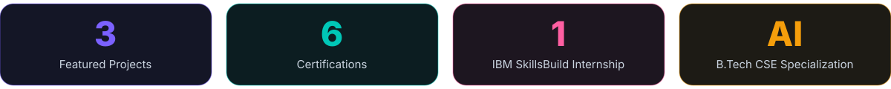
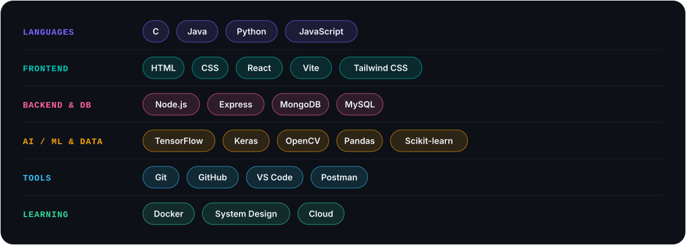
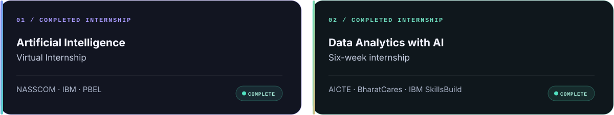

 

  

  

  

I'm a **B.Tech Computer Science (AI) student** who enjoys turning ideas into useful products. I build full-stack web applications, explore machine learning, and practice data structures and algorithms. My goal is to grow into an **AI Software Engineer**.

- 🚀 Building **[AlgoVerse](https://algoverseweb.vercel.app)**, an interactive DSA learning platform
- 🌐 Developing with React, Node.js, Express, and MongoDB
- 🤖 Exploring machine learning and deep learning
- 🧠 Learning system design, Docker, and cloud deployment
- 🎓 Completed the **AICTE × BharatCares × IBM SkillsBuild Data Analytics with AI internship (2026)**

> 💡 *Learn → Build → Improve → Repeat*

 

  

 

  

  

 

  

| Project | What it does | Links |
|:--|:--|:--|
| 🚀 **AlgoVerse** | Interactive DSA learning platform with visualizations, AI-powered features, and user authentication | [Live demo](https://algoverseweb.vercel.app) · [Source](https://github.com/VipinBhardwaj-07/AlgoVerse) |
| 🤖 **CNN Image Classification** | Classifies cats and dogs using TensorFlow, Keras, and OpenCV | [Source](https://github.com/VipinBhardwaj-07/CNN-Image-Classification) |
| 🌐 **Personal Portfolio** | Responsive portfolio built with React, Vite, and Tailwind CSS | [Live site](https://vipinbhardwaj-07.github.io/VipinBhardwaj-portfolio/) · [Source](https://github.com/VipinBhardwaj-07/VipinBhardwaj-portfolio) |

 

 

  

 

 

 

  

- 🚀 Build and ship production-ready applications
- 🤖 Create practical AI/ML projects
- 📚 Get stronger at DSA and problem-solving
- 🌐 Contribute to open source

 

