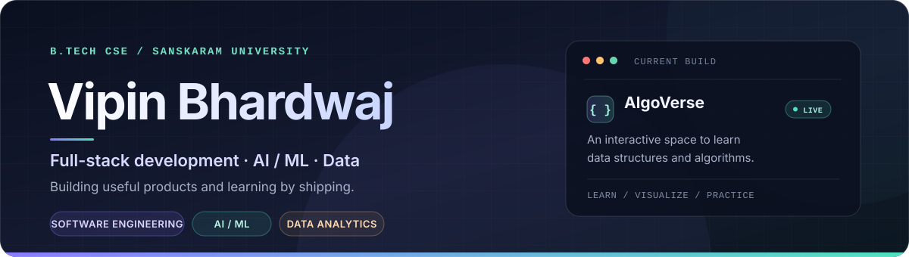

 

<a href="https://vipinbhardwaj-07.github.io/VipinBhardwaj-portfolio/">Portfolio</a>
&nbsp;·&nbsp;
<a href="https://algoverseweb.vercel.app">AlgoVerse · Live</a>
&nbsp;·&nbsp;
<a href="https://www.linkedin.com/in/vipin-bhardwaj-55a5a93a9">LinkedIn</a>
&nbsp;·&nbsp;
<a href="mailto:vipinbhardwaj0827@gmail.com">Email</a>

  

<a href="#professional-summary">ABOUT</a>
&nbsp; / &nbsp;
<a href="#technical-skills">SKILLS</a>
&nbsp; / &nbsp;
<a href="#selected-projects">PROJECTS</a>
&nbsp; / &nbsp;
<a href="#internship-experience">EXPERIENCE</a>
&nbsp; / &nbsp;
<a href="#education">EDUCATION</a>

---

## Professional Summary

I'm **Vipin Bhardwaj**, a **B.Tech Computer Science Engineering student at Sanskaram University (2024–2028)**. I build and document projects spanning full-stack web development, data analytics, and machine learning—from an interactive data-structures learning platform to reproducible analysis and computer-vision experiments.

I’m developing practical software engineering skills through project work: breaking problems into features, building usable interfaces, analyzing data, and sharing the results in public repositories. I’m interested in **software engineering and AI/ML opportunities** where I can keep learning while contributing to real products.

**Focus areas:** Software Engineering · Full-Stack Development · Data Structures & Algorithms · Applied Machine Learning · Data Analytics

## Technical Skills

- **Programming languages:** Python, Java, C, JavaScript
- **Web development:** HTML5, CSS3, React, Vite, Tailwind CSS, Node.js, Express.js
- **Data and machine learning:** Pandas, NumPy, scikit-learn, TensorFlow, Keras, OpenCV, Matplotlib, Seaborn, Jupyter Notebook
- **Databases:** MongoDB, MySQL
- **Developer tools:** Git, GitHub, VS Code, Postman
- **Computer science:** Data structures and algorithms, CNN-based image classification, exploratory data analysis, data visualization, linear regression, K-means clustering

## Selected Projects

### [AlgoVerse — Interactive DSA Learning Platform](https://github.com/VipinBhardwaj-07/AlgoVerse) · [Live demo](https://algoverseweb.vercel.app)

An educational web platform designed to make data structures and algorithms easier to explore through structured learning content and visual resources.

- Organized DSA roadmaps, learning modules, and coding resources in one place.
- Designed a responsive interface with a modern dark theme and interactive elements.
- Published a live version with Vercel.
- **Technologies:** HTML5, CSS3, JavaScript, Vercel

### [Supermarket Sales Analysis](https://github.com/VipinBhardwaj-07/Supermarket-Sales-Analysis)

An end-to-end data analytics and machine learning project examining sales patterns and customer behavior using a reproducible, synthetically generated dataset of 1,000 transactions.

- Prepared data and performed exploratory analysis across products, branches, customer types, and shopping times.
- Created nine visualizations to communicate sales and customer trends.
- Applied linear regression for sales prediction and K-means clustering for customer segmentation.
- Included an executed Jupyter notebook, reusable scripts, and a project report.
- **Technologies:** Python, Pandas, NumPy, scikit-learn, Matplotlib, Seaborn, Jupyter Notebook

### [CNN Image Classification — Cats vs. Dogs](https://github.com/VipinBhardwaj-07/CNN-Image-Classification)

A computer-vision project using a convolutional neural network (CNN) for binary image classification.

- Implemented image preprocessing and model training with TensorFlow/Keras.
- Added a prediction script for custom images and accuracy/loss visualizations.
- The repository reports **90%+ training accuracy**; this figure is training performance, not a validation or test-set result.
- **Technologies:** Python, TensorFlow, Keras, OpenCV, NumPy, Matplotlib

### [Personal Portfolio](https://github.com/VipinBhardwaj-07/VipinBhardwaj-portfolio) · [Live site](https://vipinbhardwaj-07.github.io/VipinBhardwaj-portfolio/)

A responsive portfolio website built as a component-based React application.

- Structured the site into reusable components and centralized content in a data file.
- Added animated interactions with Framer Motion and a rule-based FAQ assistant.
- Configured the project for deployment on GitHub Pages.
- **Technologies:** React, JavaScript, Vite, Tailwind CSS, Framer Motion

## Internship Experience

### Artificial Intelligence Virtual Internship
**NASSCOM · IBM · PBEL** — Completed

Completed a virtual internship focused on artificial intelligence.

### Data Analytics with AI Internship — Six Weeks
**AICTE · BharatCares · IBM SkillsBuild** — Completed

Completed a six-week internship focused on data analytics with AI. Related project work: [Supermarket Sales Analysis](https://github.com/VipinBhardwaj-07/Supermarket-Sales-Analysis).

## Education

**Bachelor of Technology (B.Tech), Computer Science Engineering** · Sanskaram University · **2024–2028**

## Certifications

- Python — GUVI
- Cloud Computing — Infosys
- YUVA AI — TCS iON
- PBEL — NASSCOM
- Generative AI — SJF
- Data Structures & Algorithms — Skill Up

## Contact

I’m always glad to connect with people working on software, AI, and data projects.

- **Portfolio:** [vipinbhardwaj-07.github.io/VipinBhardwaj-portfolio](https://vipinbhardwaj-07.github.io/VipinBhardwaj-portfolio/)
- **GitHub:** [github.com/VipinBhardwaj-07](https://github.com/VipinBhardwaj-07)
- **LinkedIn:** [linkedin.com/in/vipin-bhardwaj-55a5a93a9](https://www.linkedin.com/in/vipin-bhardwaj-55a5a93a9)
- **Email:** [vipinbhardwaj0827@gmail.com](mailto:vipinbhardwaj0827@gmail.com)

 

**Building steadily. Learning continuously.**

