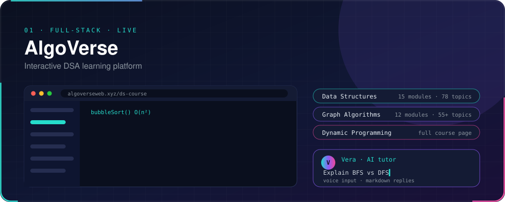
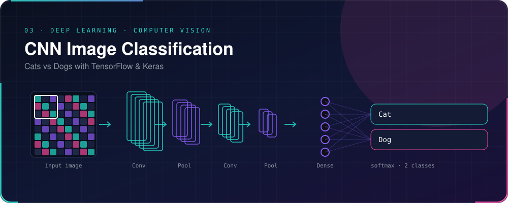

 

 

Hey! I'm **Vipin Bhardwaj**, a Computer Science undergraduate who likes building practical software at the intersection of **AI, machine learning, data, and full-stack development**.

- 🎓 B.Tech in Computer Science & Engineering (AI) — Sanskaram University, 2024–2028
- 🤖 Aspiring **AI Software Engineer** · looking for **AI/ML, Python Development, or Software Engineering internships**
- 🧪 I learn by building — concepts become projects, projects become lessons
- 🌱 Currently strengthening DSA, software development, and applied AI
- 🤝 Open to internships, learning opportunities, and collaborative projects

> **My approach:** *Learn deeply. Build thoughtfully. Improve continuously.*

 

<!-- ============================ 01 ALGOVERSE ============================ -->

### 01 · AlgoVerse — Interactive DSA Learning Platform

**A DSA learning platform that turns abstract algorithms into things you can see, run, and practise.**

| 🎯 **Problem** | 💡 **Solution** |
|---|---|
| DSA is hard to learn from static text — you can't *see* how an algorithm moves. | Interactive visualizations, structured course pages, quizzes, and an AI tutor in one place. |

**What's inside**

- 📚 **Full course pages** — Data Structures (15 modules, 78 topics), Graph Algorithms (12 modules, 55+ topics), and Dynamic Programming
- 🎬 **Algorithm visualizations & SVG diagrams** with real-world examples
- 🧩 **Practice tools** — challenge consoles with difficulty-tagged exercises, MCQ quizzes, "Interview Ready" sections
- 🤖 **Vera, an AI tutor** — chatbot powered by the Anthropic API with voice input, markdown replies and quick-topic chips
- 📈 **Progress tracking**, collapsible sidebar navigation, and a responsive mobile layout
- 🔐 Authentication and backend-powered features

**Tech:** `HTML` `CSS` `JavaScript` `Node.js` `Express.js` `MongoDB` `Anthropic API`

<!-- ============================ 02 SALES ============================ -->

### 02 · Supermarket Sales Analysis — Data Analytics

**Exploring transaction patterns and customer behaviour through visualization and machine learning.**

| 🎯 **Goal** | 🔬 **Method** | 📊 **Result** |
|---|---|---|
| Understand what drives sales and how customers group by spending. | Cleaning → EDA → Linear Regression → K-Means clustering | R² = **0.891**, MAE = **54.43** sales units, **3** spending segments |

- Analysed **1,000 synthetic transaction records**
- Built **9 visualizations** covering product, sales, and customer trends
- Completed as part of the **IBM SkillsBuild** data analytics programme

> ℹ️ *The dataset is synthetic. Metrics describe this project's data and are not validated business forecasts.*

**Tech:** `Python` `Pandas` `NumPy` `Matplotlib` `Seaborn` `Scikit-learn` `Jupyter Notebook`

<!-- ============================ 03 CNN ============================ -->

### 03 · CNN Image Classification — Cats vs Dogs

**A Convolutional Neural Network that learns to tell cats from dogs.**

- Built an end-to-end CNN workflow with **TensorFlow & Keras** — data preparation, training, prediction
- Explored training behaviour and inspected model predictions
- Repository reports **90%+ training accuracy** *(training accuracy — not a held-out test result)*

**Tech:** `Python` `TensorFlow` `Keras` `CNN` `Computer Vision` `Jupyter Notebook`

<!-- ============================ 04 PORTFOLIO ============================ -->

### 04 · Personal Portfolio — Developer Website

**A responsive, animated site presenting my background, skills, projects, and journey.**

- Project-focused layout with smooth motion effects
- Skills, certifications, and contact sections
- Rule-based FAQ assistant

**Tech:** `React` `Vite` `JavaScript` `Tailwind CSS` `Framer Motion`

 

**Languages** 

**Frontend & Backend** 

**AI, ML & Data** 

 

**Databases & Tools** 

 

| Programme | Organization / Partners | Duration |
|---|---|---|
| 📊 **Data Analytics with AI Internship** | AICTE · BharatCares · IBM SkillsBuild | 6 weeks · 17 Aug – 30 Sep 2026 |
| 🤖 **Artificial Intelligence Virtual Internship** | NASSCOM · IBM · PBEL | Virtual internship |

<b>🎓 Certifications & Learning</b> (click to expand)

 

- 🐍 Python — GUVI
- ☁️ Cloud Computing — Infosys
- 🧠 YUVA AI — TCS iON
- ✨ Generative AI — SJF
- 🧮 Data Structures & Algorithms — Skill Up
- 🤖 AI / PBEL learning programme — NASSCOM

 

| 📚 Explore | 🛠️ Build | 🔍 Analyse | 🚀 Improve |
|:---:|:---:|:---:|:---:|
| Learn concepts and fundamentals | Turn ideas into working projects | Test, debug, and understand results | Refine code and keep learning |

<!-- Contribution snake: appears after the workflow in .github/workflows/snake.yml runs once -->
<picture>
  <source media="(prefers-color-scheme: dark)" srcset="https://raw.githubusercontent.com/VipinBhardwaj-07/VipinBhardwaj-07/output/github-snake-dark.svg"/>
  
</picture>

I'm always happy to connect with developers, learn from others, and collaborate on meaningful projects.

